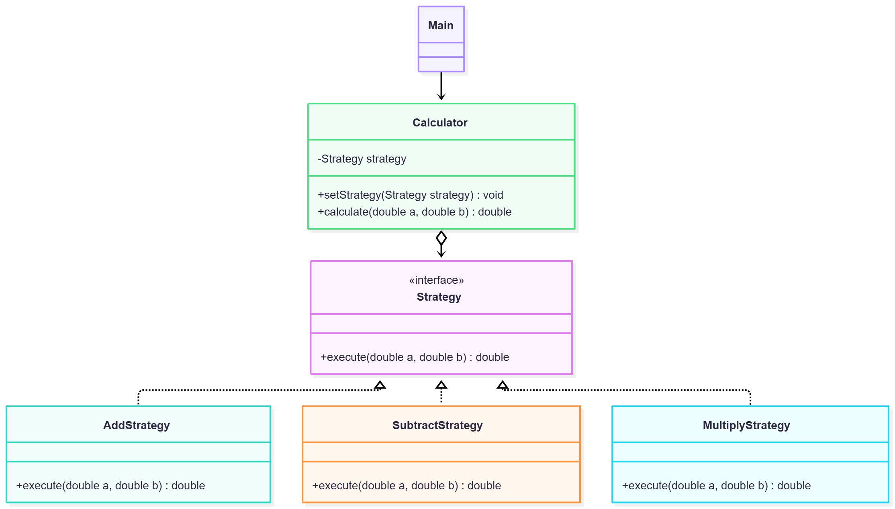

# Assignment 5 — Strategy Pattern

## 1. Introduction

This project implements the Strategy design pattern using a calculator. The calculator supports addition, subtraction, and multiplication. Each operation is implemented as a separate strategy.

## 2. UML Class Diagram

## 3. Clean Code Principles

### 1. Meaningful Names
Class names such as `AddStrategy` and `MultiplyStrategy` clearly describe their purpose.

### 2. Single Responsibility Principle
Each strategy performs only one mathematical operation.

### 3. Polymorphism
All strategies implement the same interface, allowing the calculator to execute different algorithms through a common method.

### 4. Separation of Concerns
The `Calculator` class manages strategy execution, while concrete strategy classes perform calculations.

### 5. Open/Closed Principle
New operations can be added by implementing `Strategy` without modifying the existing calculator class.

## 4. Strategy vs. State

The Strategy pattern is appropriate because the calculator can use different algorithms selected by the client. The client explicitly chooses which operation to perform. The State pattern is different because an object's behavior changes according to its internal state.

## 5. Conclusion

The Strategy pattern makes the calculator flexible and maintainable. It allows algorithms to be changed at runtime and makes it easier to add new operations. The main trade-off is the additional classes required for each strategy.

## 6. GitHub Repository

Repository:https://github.com/ayaaan676/assignment5_strategy_sarbasovayan